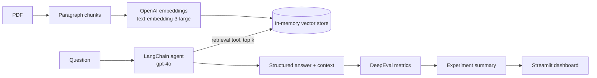
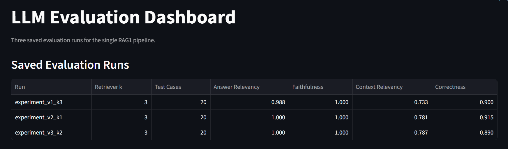
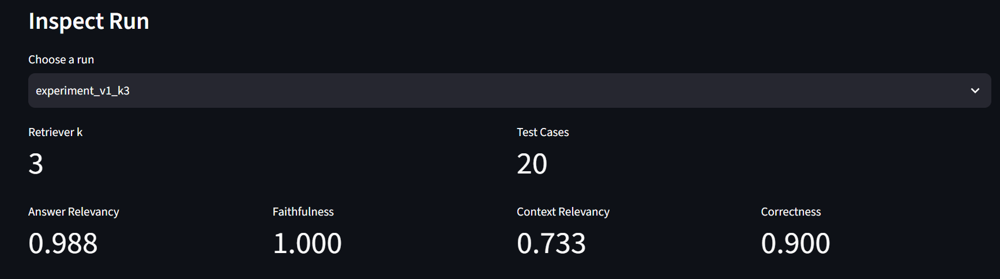

# LLM Evaluation System

An end-to-end evaluation setup for a RAG agent. A LangChain agent answers questions about a PDF, and its answers are scored with [DeepEval](https://github.com/confident-ai/deepeval) on four metrics. Experiments with different retrieval settings are saved, compared, and visualized in a Streamlit dashboard.

## How it works



1. `RAG1/indexing.py` splits `pdfs/Penguins_ACL.pdf` into paragraphs, embeds them and stores them in an `InMemoryVectorStore`.
2. `RAG1/agent.py` builds a `gpt-4o` agent (temperature 0) with one retrieval tool and a structured `Answer` output (answer plus the context used).
3. `RAG1/tools.py` runs the similarity search. The `k` value there is the main experiment knob.
4. A runner asks every question in `eval_dataset.jsonl` (20 questions with expected answers) and saves answers and retrieved context.
5. DeepEval scores each answer, and a summary script averages the scores into an experiment file.

## Metrics

| Metric | What it checks |
|---|---|
| Answer relevancy | Does the answer address the question? |
| Faithfulness | Is the answer supported by the retrieved context (no hallucination)? |
| Contextual relevancy | Is the retrieved context actually relevant to the question? |
| Correctness (G-Eval) | Does the answer match the expected answer? |

## Results

Each version is the same pipeline run with a different retrieval size `k`.

| Experiment | k | Answer relevancy | Faithfulness | Context relevancy | Correctness |
|---|---|---|---|---|---|
| v1 | 3 | 0.988 | 1.000 | 0.733 | 0.900 |
| v2 | 1 | 1.000 | 1.000 | 0.781 | 0.915 |
| v3 | 2 | 1.000 | 1.000 | 0.787 | 0.890 |

Smaller `k` returns more focused context, which raises context relevancy from 0.73 to about 0.78, while answer quality stays high. DeepEval metrics use an LLM judge, so reruns can vary by a few points.

## Project structure

```
RAG1/                 RAG agent: PDF reader, indexing, retrieval tool, prompts, output schema
versions/v1..v3/      Per-experiment runner, metric scripts, summary and saved results
single_tests/         Standalone scripts, one metric on one test case each
eval_dataset.jsonl    Questions and expected answers
experiment_v*.jsonl   Averaged scores per experiment
save_experiment.py    Builds an experiment summary from evaluated results
compare_experiments.py  Prints a metric-by-metric comparison of two experiments
dashboard.py          Streamlit dashboard comparing all experiments
screenshots/          Dashboard screenshots
```

## Setup

Requires Python 3.13 and [uv](https://docs.astral.sh/uv/).

```bash
uv sync
cp .env.example .env   # then set OPENAI_API_KEY
```

## Usage

Run from the project root.

```bash
# 1. Generate answers for the dataset
uv run python -m versions.v1.eval_runner1

# 2. Score them with DeepEval
uv run python -m versions.v1.eval_all_metrics1_fast

# 3. Summarize and save the experiment
uv run python -m versions.v1.evaluation_summary1
uv run python save_experiment.py

# Dashboard
uv run streamlit run dashboard.py

# A single metric on a single test case
uv run python single_tests/test_single_eval_faithfulness.py
```

To run a new experiment, change `k` in `RAG1/tools.py` and use the matching `versions/vN` scripts.

## Dashboard




## Tech stack

Python, LangChain, OpenAI (`gpt-4o`, `text-embedding-3-large`), DeepEval, PyMuPDF, pandas, Streamlit, uv.
